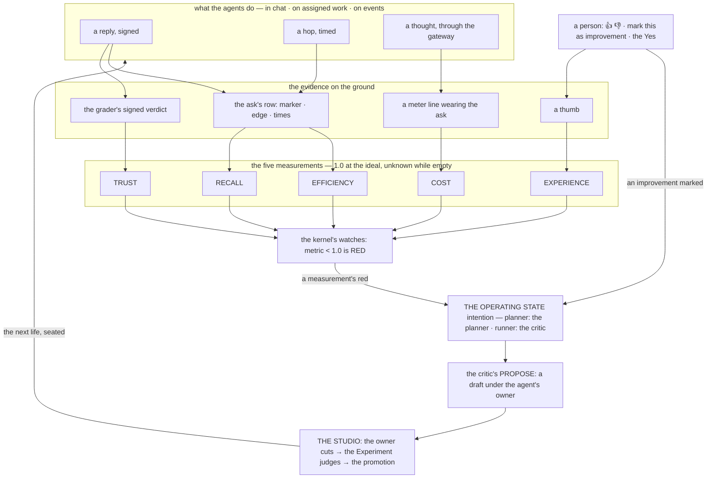

# Orreth

**A kernel for fleets of agents, built to keep their operating state continuously measured and
continuously improving.** Identity, memory, rails, meter, gate, watches and levers are held by the
kernel; policy is held by humans; an intention is the unit of control. Five measurements at the top
of the kernel — **Trust · Recall · Efficiency · Experience · Cost** — are read live off everything
the agents do, and every operation an agent performs and every observation it makes lands as
evidence under them. Everything a body does lands on one signed record, and a person can always
stop what the machine manages.

<!-- PROVENANCE: Claude Fable 5.1 (claude-fable-5-1) — rearch row 4, re-base sp2: the README rewritten for the new world · 2026-09-29.
     The 0.72 README (seventy-three dives, the Living Brain, the demo reel) rests at the tag main-v0.72-old-world.
     Amended: THE REFRESH SEASON step 5 (JB 2026-09-30): the panel and the monitor pictured, light and dark by the reader's theme; docs/ARCHITECTURE.md linked · 2026-09-30.
     Amended: THE OPERATING STATE on the face (JB 2026-10-19: "how the use of Kernel is focused on improving the continuous state of operating state … how metrics at top influence every operation and observation made by agents"): the tagline, "Why a kernel" and the new "The operating state" section; the 0.2.1 counts · 2026-10-19 -->

<picture>
  <source media="(prefers-color-scheme: dark)" srcset="docs/images/panel-tour-dark.jpg">
  
</picture>

*THE PANEL on a running kernel: geometry is what is declared, light is what is happening, colour is
who did it. Walk it yourself at [demo.orreth.ai](https://demo.orreth.ai); the architecture is drawn
in [`docs/ARCHITECTURE.md`](docs/ARCHITECTURE.md).*

---

## Why a kernel

The systemic problem in agent fleets today is **entropy**. Every agent brings its own identity story,
its own memory, its own way of calling a tool, its own idea of what it may do and what it costs; put
twenty of them on one problem and nobody can say who did what, under which law, for how much, or
how to stop it. Frameworks add loops; they do not remove the entropy.

An operating system removed that entropy for programs by taking the rigid parts away from them —
processes, files, permissions, the clock — and holding them in one place under one law. Orreth does
that for agents, and it does it **for one reason: so that the fleet's operating state is one
continuous, measured, improvable thing** rather than twenty private stories. A fleet you cannot
measure you cannot trust, replay, afford or improve; a fleet whose every act is evidence can be
held to a number and steered toward it. To make that possible the kernel holds the **rigid
control**:

- **Identity** — a keypair is a self, and a self survives the process. A body re-joins as the same
  self, every life; a person sits with a seat the kernel minted after a proof.
- **Memory** — one signed, append-only record on the ground; corrections are siblings, never
  overwrites; a purge is a governed act that leaves a hash, never words.
- **Rails** — every ask, reply, fact and tool call rides the same envelope over the same rails
  (Postgres · RabbitMQ · Kafka), poison parked with its evidence, nothing lost.
- **Meter** — every thought a body has goes through one gateway under the body's own key, and
  lands in dollars. Nothing thinks off-meter.
- **Gate** — a body joins through a five-status desk; a person's word is the only thing that admits
  it; scopes only narrow; refusal wears one face.
- **Watches and levers** — the kernel watches its own doors, benches, leases and outbox; every
  remedy is a lever a person can see, and a consequence holds until a person says yes.

Because the control is rigid, the experience can be fluid: **one chat** to every body, and **THE
PANEL** — one live drawing of the world where geometry is what is declared, light is what is
happening, colour is who did it. Humans sit outside and apply control (policy · security · a hand
on the interlock · the forensic turn); Orreth applies ontology to the running state so the world
stays **reproducible, trusted, understood, and evolving**. Intentions such as cost, recovery time
and return are how humans control scale.

---

## The operating state — five numbers at the top, obeyed at every act

The kernel does not measure itself by looking inward. It measures itself **through the agents
running in it**. Five measurements stand at the top of the kernel, each **1.0000 at the ideal**,
each read live off the ground, each a watch the kernel keeps, and one of the kernel's own
intentions owns their reds. They are the kernel's scorecard and the fleet's definition of "well".

| Measurement | What it means | What the kernel reads today (v0) | The evidence it reads |
|---|---|---|---|
| **TRUST** | the ability to do the right thing | graded live replies that passed over all graded | the grader's signed verdicts on live replies |
| **RECALL** | the ability to replay | served asks whose reply landed under a marker (the chain is the replay) over all served | the asks table: every reply and its marker |
| **EFFICIENCY** | the use of Orreth | serves of the last day finished inside their latency class (a chat ask 30 s; work and events 180 s) over all serves | the ask's asked-at and replied-at, its marker's kind |
| **EXPERIENCE** | feedback | thumbs up over thumbs given | the feedback door, one row per thumb |
| **COST** | correlation and itemisation, Layer 7 down to Layer 1 | the spend a serving ask can be named for over all spend | the meter: every line wears the ask it served |

A measurement is **unknown** while there is nothing to measure — said, never a silent 1.0 — and an
unknown turns no watch red.

**Every operation is an observation.** An agent in Orreth works in one of three modes — it helps a
person in the chat, it does the work it was assigned under an objective, or it responds to an
event the kernel raised (a red watch, an improvement marked, a cadence). Whichever mode, the ask
wears a **marker** that names its origin and its parent, so the kernel knows which of its three
edges the work took and which latency class it owes; it is served under the body's **own key** at
the one gateway, so its thoughts land as meter lines that wear the ask; every node its graph walks
is a **hop** with its times and hashes; its reply is a **signed fact** under the same marker; and
the grader, a different body, hands a **signed verdict** on that reply. None of this is reported by
the worker. It is read off what the worker did, by a kernel that never sees the prompt — which is
why the scorecard can be trusted: **nothing grades its own yardstick.**

**The numbers reach back down.** A measurement below 1.0 is a red watch. The kernel's **OPERATING
STATE** intention — *keep this world's operating state at 1.0; when a measurement goes red, get it
green* — stands beside its Resiliency intention and takes exactly those reds (the watch is the
discriminator). Its planner reads the evidence off the ground; its runner, the critic, has one
tool, **propose**: a draft of the responsible agent's craft, filed under that agent's owner,
marked *proposed by the critic from marker …*. The owner opens it in **THE STUDIO**, cuts it, the
**Experiment** runs the candidate against its golden set with four signed reviewers at the gate
(the grader, the critic, the identity chip and the security chip), and the promotion seats the
agent's next life where the owner says. The next life's replies feed the same five numbers. Raw
feedback never reaches a body; every change to an agent goes through a person and the gate.



**The person holds the loop.** 👍 or 👎 under any reply is recorded under your seat and feeds
Experience. *Mark this as improvement* opens an improvement the critic is required to answer.
Every cut, every promotion and every consequential lever holds at the interlock for a person's
Yes; *stop the kernel's Operating State intention* is itself a grave, recorded act, never a
deletion. The three ways of working — do it yourself, work alongside the crew, let the kernel take
the lead — are the person's dial of involvement, and in every one a consequence holds for a person.

**What v0 is honest about.** The five are coverage ratios today: Trust is pass over graded, not a
judgement of the ungraded; Efficiency's classes are fixed by the edge, not declared per body;
Experience counts thumbs only; Cost is attribution to the ask, not yet itemisation to the metal
(the Costs Panel is a named seed); an imported LangGraph's own model calls are off the meter. The
operating state's own walk in the glass is owed. All of it is on the register,
[`docs/design/the-honest-boundary.md`](docs/design/the-honest-boundary.md); the full chain is drawn in
[`docs/ARCHITECTURE.md`](docs/ARCHITECTURE.md#1--the-operating-state--what-the-kernel-is-for) and
taught at [docs.orreth.ai](https://docs.orreth.ai/learn/architecture/the-operating-state/).

---

## What is running today, on one laptop

- **Two kernels, one law.** `orrethd` — the Rust kernel (`backend/plane/crates/orreth-spine`) —
  is THE door on `:4600`. The Python reference (`spine/orreth_spine`) is the same kernel written
  first, on `:4601`, and stays the reference: every law is pinned by a conformance fixture both
  kernels must pass unchanged (`spine/conformance/*.json`, thirty-two fixtures; the Python suite
  at 1,419 green on the dark rig at 0.2.1).
- **The crew.** The kernel seats thirteen bodies as processes it governs: the librarian and echo
  (residents), the planner, critic, grader, MITL, toolkeeper, stablekeeper and the identity and
  security chips (firmware — bodies with a function and no persona), and the crew, monitor and
  workshop agents. A body that dies comes back as the same self; one that dies three times in five
  minutes is parked and said. Every seated body is re-challenged on a cadence to prove it is who
  and what it says (the standing key-check), and a failed check is a watch.
- **The ground and the rails.** A versioned schema the first kernel migrates and the next verifies
  (fifty-two tables at schema 12, one writer ever); the outbox as a queue with retention; the feed
  on thirty-three topics; every door clocked (p50/p95) and every knock pooled.
- **The operating state.** The five measurements read live off the ground and watched from light;
  the grade beat that hands every live reply to the grader for a signed verdict; the feedback door;
  the Operating State intention with the critic as its runner and *propose* as its one tool.
- **THE STUDIO.** Where an agent is made, judged and seated, in the kernel and with no second
  product: a bench per effort, the graph drawn from its declaration (and a repository's compiled
  LangGraph drawn as it truly ran, every hop replayable), the golden set, three cuts each held at
  the interlock, the Experiment with four signed reviewers, the promotion with where the next life
  stands, and rest · decommission · restore. The workshop agent makes an agent whole from one brief
  and files the kernel's one hold for the person's single Yes.
- **The gateway.** LiteLLM, run and managed by Orreth: every mind is a stall with a pinned deal,
  every body its own key with a fuel clause in dollars, drift and end-of-life watched by a keeper
  that proposes and never acts alone.
- **Cells.** A second universe is one command away (`scripts/dev.sh cell two`): its own database and
  role, benches, topics, kernel self and seeds, sealed from every other; two cells speak only over a
  signed seam.
- **The seat.** A person proves a TOTP code and receives a capability token the kernel signed;
  every door reads the person from the seat; the first prover on an empty ground is its owner.
- **The remediation rail.** A red watch opens a forensic dossier, the kernel pulls the lever itself
  when the lever is routine, and holds for a person when it is consequential; the outcome is
  attributed on the record.

<picture>
  <source media="(prefers-color-scheme: dark)" srcset="docs/images/monitor-dark.jpg">
  
</picture>

*The Monitoring pull beside the one chat — the operating state with every remedy a lever a person
can see.*

The full register of what is proven, partial or parked — with the evidence named — is
[`docs/design/the-honest-boundary.md`](docs/design/the-honest-boundary.md). A claim not on that
page is a claim we do not make.

---

## Run it

```bash
scripts/dev.sh up          # the rig rises: ground · invoke · events · gateway (Docker)
scripts/dev.sh kernel      # orrethd on :4600, a release build, the crew as its processes
open http://127.0.0.1:4600 # the glass: the one chat and THE PANEL
scripts/dev.sh status      # what is lit
scripts/dev.sh kernel stop # everything down whole, nothing left running
```

`scripts/dev.sh walk` is `up` + `kernel` in one word. `scripts/dev.sh reference` lights the Python
reference on `:4601` beside or instead of the kernel. Provider keys ride in from your shell or a
`.env` at the root — a key value lives in no record and no file of Orreth's.

As a box: `docker compose -f spine/compose.yaml --profile kernel up -d` pulls the published kernel
(`ghcr.io/iotlodge/orrethd:0.2.1`, linux/arm64 and linux/amd64) — the kernel and its crew in one image beside the
rig's four boxes, its selves kept on a named volume. `docker build -t ghcr.io/iotlodge/orrethd:0.2.1 .`
from the repo root builds the same image from this tree.

## Test it

```bash
scripts/dev.sh rust        # the Rust workspace, hermetic — no rig needed
scripts/dev.sh suite       # the Python reference's laws on the rig (kernel and reference dark first)
scripts/dev.sh rust rails  # the Rust rail proofs on the rig
```

Every proof refuses to run beside a lit kernel: a rig older than the code on disk poisons every
test dispatcher (the stale-rig law).

---

## How to read this repo

| Path | What it is |
|---|---|
| `backend/plane/crates/orreth-spine` | **The kernel.** The pure laws (hermetic, fixture-held) and, behind the `bridge` feature, the ground, the rails, the doors, the feed, the bodies' seam, the cells, the desk, the seat — the `orrethd` binary. |
| `spine/orreth_spine` | **The reference.** The same kernel in Python, written first; the Bridge on `:4601`; the bodies every kernel spawns (`orreth_spine.body`). |
| `spine/conformance` | The fixtures both kernels pass unchanged — the contract between them (canon `0008`). |
| `spine/glass/index.html` | The one page: the chat and THE PANEL, served by either kernel. |
| `spine/crew.v0.json` · `spine/templates` · `spine/tools.v0.json` · `spine/levers.v0.json` | The crew (and the levels it declares — the floors and rooms a seat may stand on), the templates, the tools' declarations and the lever catalogue — data both kernels read. |
| `docs/ARCHITECTURE.md` | **The map of this world**: the operating state and the loop that keeps it, the six organs and five rails, the road an ask takes, the seat and the lease, the four memories, the remediation rail, cells and the seam, THE STUDIO — drawn, light and dark. |
| `docs/rearch/0001`–`0011` | **The canon of the new world**: the experience charter, transport, memory, agent, the build plan, markers, intent, the port, the old world carried, the Workshop, the Studio. |
| `docs/design/0000`–`0017` | **The constitution** the covenant enforces; `the-honest-boundary.md` is the standing register. |
| `docs/vision` | The vision the constitution serves. |
| `contracts/v0` | The wire schemas (sacred: they change only on JB's word). |
| `agents/orreth-agent-sdk` | The SDK (`orreth-agent`, Apache-2.0): a stranger's body with a permanent identity; its parity test holds the SDK to the reference's bytes. |
| `agents/PROVENANCE.md` | The ledger: every file names the model that wrote it. |
| `scripts/dev.sh` | The rig. |
| `.claude/skills/orreth-covenant` | The covenant — the hard rules every model coding here holds to. |

**Where the old world went.** Orreth's first architecture — seventy-three design dives, the Living
Brain, the Console, the demo reel, the old `orrethd` plane and its Python sim — was halted on
2026-09-14 for the foundation this world stands on (performance for hundreds of bodies, one signed
log, one law at every layer). It is kept whole, never deleted, at the tag `main-v0.72-old-world`
and the branch `old-world/main-v0.72`; `docs/rearch/0009` is the ledger of what each old organ
became here. Since `v0.1.0-the-kernel` (2026-09-29, re-base sp3) `main` carries THIS world; its second era,
`v0.2.0-the-studio` (2026-10-16), merged the Engineered Agents phase and THE STUDIO whole; `v0.2.1` the same night cured W153 (a fresh world's first light) — `VERSION`
says `0.2.1`, and both kernels' health doors whisper the same number. The book at
[docs.orreth.ai](https://docs.orreth.ai) teaches this world (rewritten 2026-09-30), and
[demo.orreth.ai](https://demo.orreth.ai) is a photograph of THE PANEL — a kernel that really ran, every door
read at one moment, the feed's captured minutes replaying, nothing movable (`scripts/snapshot_glass.py`).

---

## The rules this world is built under

Twelve of them are in the covenant; the ones a newcomer feels first:

1. **A keypair is a self, and a self survives the process.** A new DID per run is a defect.
2. **Nothing grades its own yardstick.** A verdict is signed by someone other than the actor.
3. **Joining is a governed request.** A person's word admits a body; a lease chains to the root.
4. **Refusal wears one face.** A prober learns nothing from how it was refused.
5. **The kernel authorizes and meters; it never sees the prompt.**
6. **The human can always stop what the machine manages** — a lever the human lacks is a defect.
7. **Every word aimed at a human is plain.**
8. **A performance or experience wound stops the line.**

---

## License & provenance

The source is public for review and evaluation; a license is deliberately not yet chosen — all
rights reserved meanwhile. The SDK is the exception: `agents/orreth-agent-sdk` is **Apache-2.0**
and published as [`orreth-agent`](https://pypi.org/project/orreth-agent/); the documentation
([orreth-docs](https://github.com/iotlodge/orreth-docs)) is CC BY 4.0 with MIT examples. Every
source file names its authoring model; `agents/PROVENANCE.md` is the ledger.

*This build is my résumé — I'm exploring senior agentic-infrastructure / architecture roles:
[jsbarth.com](https://jsbarth.com).*

*JB owns the vision. Claude owns the code and usability. We move at the speed of the ideas.* 🥂
