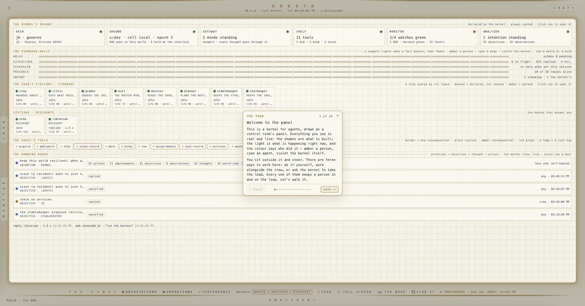
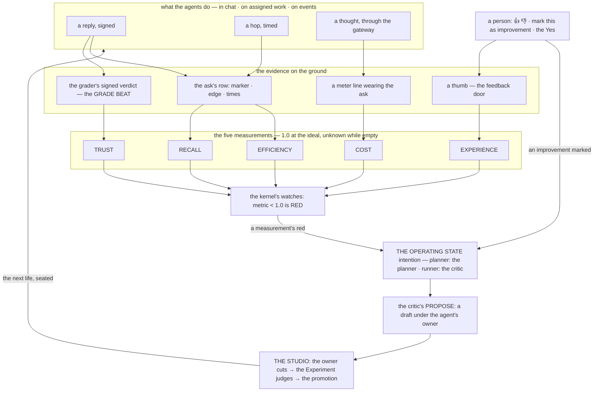
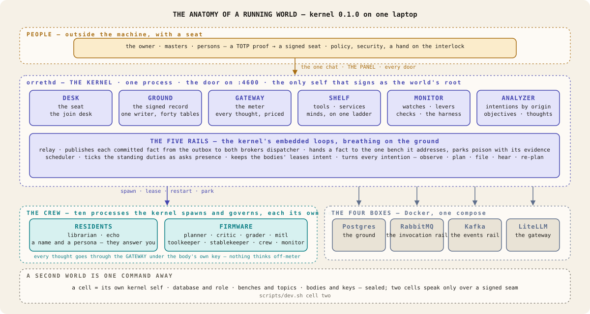
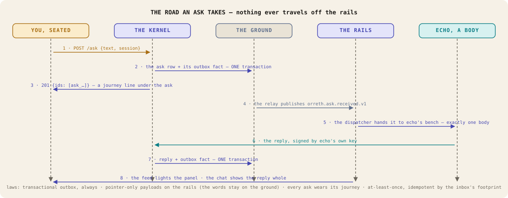
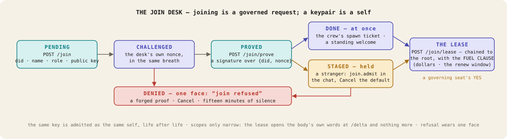
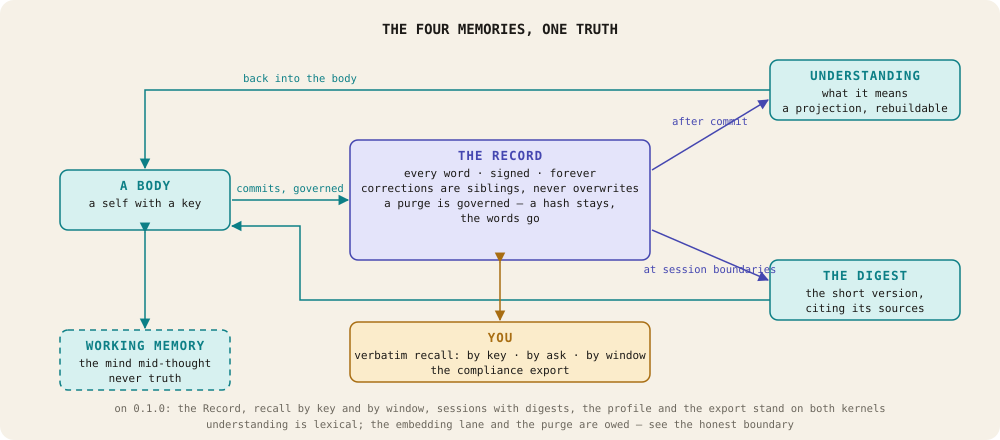
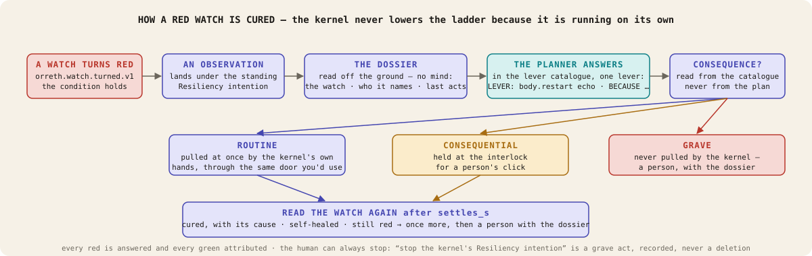
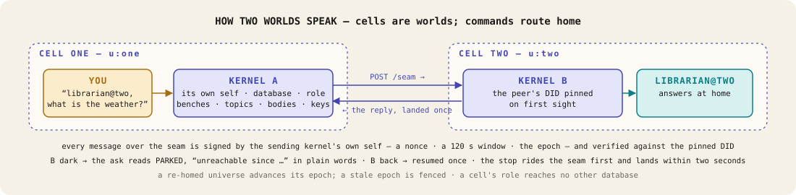
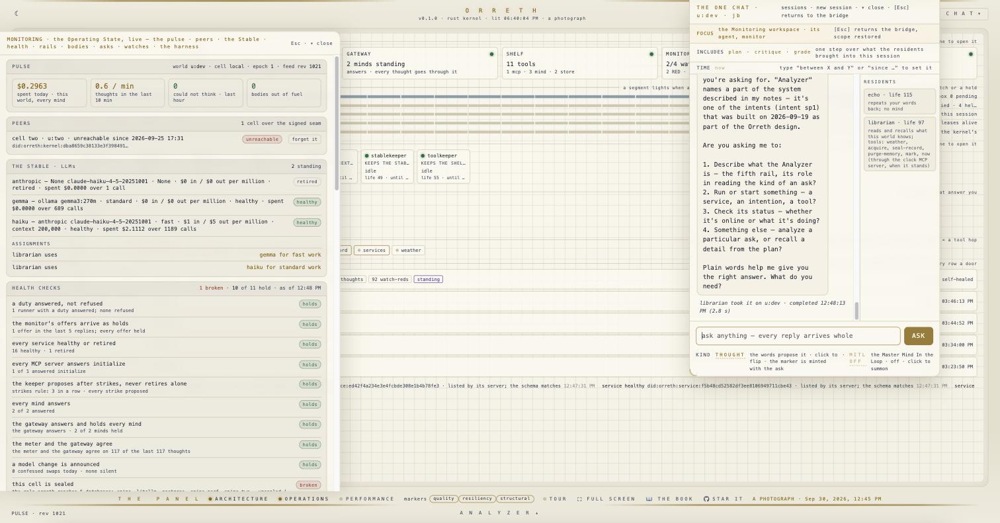

# Orreth — the architecture

<!-- PROVENANCE: Claude Fable 5.1 (claude-fable-5-1) — THE REFRESH SEASON step 5, the repo's face (JB 2026-09-30: "an Architecture markdown that has nice professional graphs … light/dark") · 2026-09-30.
     The diagrams are hand-drawn SVG in docs/images, one light and one dark file each, chosen by the reader's own theme.
     Amended: THE OPERATING STATE on the face (JB 2026-10-19): §1 the operating state and the loop that keeps it (a Mermaid drawing GitHub renders in the reader's theme), §10 THE STUDIO, the 0.2.1 counts · 2026-10-19 -->

**Orreth is a kernel for fleets of agents, built to keep their operating state continuously
measured and continuously improving.** It holds the rigid control an operating system holds for
programs — identity, memory, the rails work rides on, the meter, the gate, the watches and the
levers — in one process under one law, so that everything a body does lands on one signed record
and a person can always stop what the machine manages. Policy stays with humans. An intention is
the unit of control. And the point of all that rigid control is a scorecard: five measurements at
the top of the kernel, read live off what the agents do, obeyed at every act, and closed as a loop
that improves the agents themselves.

This page is the map of kernel **0.2.1** as it runs today: what exists, how it fits, and the laws
each part is built to keep. It draws only machinery that runs; the standing register of what is
proven, partial or owed is [`design/the-honest-boundary.md`](design/the-honest-boundary.md), and a
claim not on that page is a claim we do not make. The book at [docs.orreth.ai](https://docs.orreth.ai)
teaches the same world for a reader who wants to run it; [demo.orreth.ai](https://demo.orreth.ai)
is a photograph of it running.

<picture>
  <source media="(prefers-color-scheme: dark)" srcset="images/panel-tour-dark.jpg">
  
</picture>

*THE PANEL: the six organs, the five rails, the crew's stations, the shelf's tools and the running
board — geometry is what is declared, light is what is happening, colour is who did it. The tour
walks a newcomer through it in plain words.*

---

## 1 · The operating state — what the kernel is for

The kernel does not measure itself by looking inward. It measures itself **through the agents
running in it**: every reply a body gives, every ask it serves, every meter line its thoughts
leave, every hop its graph walks, every thumb a person puts on its answer. Those rows are the
evidence. Five measurements — the owner's **Kernel Strategic Measurements** of 2026-10-05 — are
read off them live, each **1.0000 at the ideal**; each is a watch the kernel keeps; one of the
kernel's own intentions owns their reds; and the loop closes in THE STUDIO, where the agent that
fell short is improved by a person and judged at a gate before its next life is seated.

### The five measurements

| Measurement | What it means | What the kernel reads at v0 | The evidence it reads | Unknown while |
|---|---|---|---|---|
| **TRUST** | the ability to do the right thing | graded live replies that passed (A, B or C) over all graded live replies | the grader's signed verdicts on replies (`spine_verdicts.on_ask`) | no reply has been graded |
| **RECALL** | the ability to replay | served asks whose reply landed under a marker — the chain is the replay — over all served asks | the asks table: every reply with its marker | no ask has been served |
| **EFFICIENCY** | the use of Orreth | serves of the last day finished inside their latency class over all serves — a chat ask 30 s, work and events 180 s, by the hull's edge | the ask's asked-at and replied-at, its marker's kind | nothing served in the last day |
| **EXPERIENCE** | feedback | thumbs up over thumbs given through the feedback door | the feedback table, one row per thumb | no thumb has been given |
| **COST** | correlation and itemisation, Layer 7 down to Layer 1 | the spend a serving ask can be named for over all spend | the meter: every line wears the ask it served | nothing has been spent |

Each is **unknown** while its denominator is empty — said, never a silent 1.0 — and an unknown
turns no watch red. The Monitor says each one in words, not only as a number (*trust: 0.8000 — 4
of 5 graded replies passed*; *experience: unknown — no thumbs given yet*), and the measurements
door serves the five alone. The law is pure and mirrored on both kernels
(`spine/orreth_spine/operating.py` · `operating.rs` · the fixture `operating-v0.json`).

### Every operation is an observation

An agent in Orreth works in one of **three modes**, and the kernel knows which from the ask's
marker, never from a mode switch:

| Mode | What wakes it | The hull's edge | Its latency class |
|---|---|---|---|
| **Helping a person in the chat** | a human's own ask, or a thought asked of an include in the session | chat | 30 s |
| **Doing its assigned work** | an objective's child, or an intention's occurrence — structural markers | work | 180 s |
| **Responding to an event** | a red watch, an improvement marked, an experiment's run, a grading, any declared kind the body is interested in | event | 180 s |

Whichever mode, the same things happen, and each is evidence under one of the five:

- the ask wears a **marker** naming its origin and its parent — so Recall can count the chain, and
  Efficiency can know the edge and the class the serve owes;
- the body thinks under its **own virtual key** at the one gateway, so every thought lands as a
  **meter line wearing the ask** — Cost's numerator; the kernel never sees the prompt;
- every node the body's graph walks is a **hop** on the ground — when it started, how long it took,
  whether it ended well, the hashes of what went in and out — replayable by ask, or by an
  experiment's run and case;
- the reply lands as a **signed fact** under the same marker, through the same door, over the same
  rails as everything else;
- **the grade beat** takes a body's replies of the last hour that no one has graded — five per
  beat, never a reviewer's own words — and hands each to the **grader** under a grading marker
  beneath the reply's own ask; the grader answers in one form, *grade: ‹A–F› — ‹one line›*, and
  writes its **signed verdict** on the reply in its own transaction — Trust's evidence;
- a person's 👍 or 👎 under the reply is a fact under the person's seat — Experience's evidence,
  and evidence the grader weighs, never the verdict itself.

Nothing in that list is reported by the worker. It is read off what the worker did, by a kernel
that authorizes and meters and never sees the prompt, and graded by a body other than the actor.
That is covenant rule 2 — **nothing grades its own yardstick** — applied to the whole fleet, and
it is why the scorecard can be trusted.

### The watches and THE OPERATING STATE intention

A watch is red while its condition holds (`metric op threshold`) and green otherwise. At light,
once per world, the kernel declares seven watches of its own: `trust < 1.0` · `recall < 1.0` ·
`efficiency < 1.0` · `experience < 1.0` · `cost < 1.0`; `ground_connections >= ceiling − reserve`
(the ground filling before Postgres refuses a line); `key_checks_failed > 0` (a seated body that
could not prove, on the identity chip's cadence, that it is who and what it says).

Beside its Resiliency intention the kernel declares one more of its own, **THE OPERATING STATE**:
*keep this world's operating state at 1.0 — Trust · Recall · Efficiency · Experience · Cost: when a
measurement goes red, get it green*. Both are interested in `watch-red`; **the watch is the
discriminator** — an intention that names watches takes the reds of those metrics alone, and one
that names none takes every other red. So a measurement's red reaches the Operating State, and a
red on the ground, the outbox, a body or a door reaches Resiliency and the remediation rail (§6).

### The loop closes in THE STUDIO

The Operating State's planner is the planner; its runner is the **critic**, and the critic has one
tool, **propose**. Asked under an improvement marker — a measurement's red, or a person's own
*mark this as improvement* — its recall packs the improvement marked, the marked reply and the
responsible body's template from the shelf, and its proposal lands as a **draft of that body's
craft under the body's owner** (the seat that promoted it, else the template's registrar, else the
world's owner), marked *proposed by the critic from marker …*. A fact tells the owner's chat. The
owner opens the draft in THE STUDIO (§10), cuts it at the interlock, the **Experiment** runs the
candidate against its golden set with four signed reviewers at the gate, and the promotion seats
the agent's next life where the owner says. The next life's replies feed the same five numbers.
**Raw feedback never reaches a body**; every change to an agent goes through a person and the gate.

### Itemised from the top down

Cost's phrase in the canon is *Layer 7 through Layer 1*: an act in the glass traced down to the
metal it cost. At v0 the kernel itemises this far: **the world** (the five are read per universe;
the meter by world — what this world spent today, every mind); **the body** (every body thinks
under its own key with a budget and a renewal window, the fuel clause of its lease, so spend is
itemised per body; its verdicts and thumbs are on its replies; its wear says which crafts it was
made of when it answered); **the stall** (every thought names the mind that answered, resolved by
one law and said in the journey); **the ask** (every meter line wears the ask; the verdict is on the
ask; the thumb on the reply; the latency class is the edge it took — the unit the five ratios
count); **the hop** (timed and recorded, not yet costed).

### What is not measured yet

The five are coverage ratios at v0: Trust is pass over graded, not a judgement of the ungraded;
Efficiency's classes are fixed by the edge (30 s · 180 s), not declared per body; Experience
counts thumbs only; Recall counts a marker's presence, not a replay performed. Dollars stop at
the ask — the Costs Panel's itemisation to the metal is a named seed. An imported LangGraph's own
model calls are off the meter (the kernel records its hops, not its spend). There is no roll-up
across cells. The grade beat runs on one kernel and spends; its dial turns it off. The operating
state's own walk in the glass (SPEC-OPERATING-01) is owed, and on the Studio's walk of 2026-10-16
the critic filed its proposal and closed without its verdict line, recorded as missing. All of it
is on the register.

---

## 2 · The shape of a running world

On one laptop, Orreth is five processes in Docker and, inside the kernel's own process, ten more.

<picture>
  <source media="(prefers-color-scheme: dark)" srcset="images/arch-anatomy-dark.svg">
  
</picture>

**`orrethd`, the kernel** (`backend/plane/crates/orreth-spine`) is one Rust program: the door on
`:4600`, the one page it serves, the ground's schema, the rails, the crew's seats, the watches and
the levers. It is the only self in a world that signs as the world's root.

**The six organs** are what the panel draws first, always seated, because the kernel always
carries them:

| Organ | What it is | Its doors |
|---|---|---|
| **DESK** | Who is seated and who may come in — the seat a person takes with a code from their authenticator, and the join desk every body walks through. | `/seat` · `/enroll` · `/join` |
| **GROUND** | The kernel's memory: one Postgres database, one schema with one writer ever, fifty-two tables at schema 12 — every ask, reply, fact, lease, watch, meter line, verdict, thumb and hop. | `/recall` · `/export` · `/fact/:id` · `/parked` |
| **GATEWAY** | The meter: LiteLLM, run and managed by the kernel. Every body has its own virtual key wearing its budget; every answer comes back with its cost. | `/minds` · `/minds/spend` |
| **SHELF** | Every service the kernel governs — tools, MCP servers, stores, sources and minds — and every craft a body is made of — templates, prompts, skills, policies, graphs, bindings and golden sets, addressed by name and pin, never a self — on one lifecycle ladder: registered → versioned → healthy or unhealthy → retired. The wear table says which body wears which craft at which version; a draft lives under its author until the cut. A graph declaration may branch (a way out wears `when`: the hull's edge · the ask's words · the last reply; one default at most; forward only), and the body's hull picks the way out as the run goes. | `/services` · `/wear` · `/drafts` |
| **MONITOR** | The operating state, live: the rails, the bodies, the asks, the watches, the health checks, the harness, and every lever. | `/monitor` · `/harness` · `/levers` · `/bodies` |
| **ANALYZER** | Everything born in the chat, grouped by origin — intentions, the objectives under them, in flight and done — read from the ground. | `/analyzer` · `/intentions` · `/markers` |

**The five rails** are the kernel's embedded loops, each breathing on the ground and each a segment
on the panel that lights when a fact passes:

| Rail | What it does |
|---|---|
| **relay** | Publishes each fact from the outbox to RabbitMQ and Kafka after the transaction that made it commits. A committed record can never lack its event. |
| **dispatcher** | Hands each fact to the bench of the one body it addresses. Bytes that can never apply are **parked** with their evidence until a person advances past them. |
| **scheduler** | Ticks the standing duties — the librarian's hourly review, the kernel's harness run, any cadence a body was given. Every occurrence is an ask. |
| **presence** | Keeps the bodies' leases while they serve; a lease that lapses reads dormant within seconds and the station goes dashed. |
| **intent** | Turns every intention: observes what it is interested in, asks its planner, files the objective, hears the runner, re-plans. |

**The ground's lines follow the work, never the crew** (the ground connections cure, 2026-10-08). A
body holds a connection to the ground only while it serves — taken when a command lands on its
bench, its working memory's line with it, let go a few seconds after the last serve — and keeps its
lease on a cadence with a line it opens and closes; an idle crew of any size leaves the ground
holding the kernel's lines alone. The kernel's own are a named handful: the relay's, the
dispatcher's, and two the beats borrow in turn; the doors' pool sheds lines idle past a minute.
The ground declares how many bodies it can seat so that every one of them could serve at once
(its ceiling less the kernel's reserve, two lines per serving body — 35 on a stock Postgres), and
placement refuses the body past that budget at birth, in words, recorded. The lines held right now
are a watchable metric (`ground_connections`); the kernel watches it from light, beside its five
measurements, so the Monitor shows the ground filling before Postgres refuses anyone.

**The four boxes** are the transports underneath: the **ground** (Postgres) where truth lives, the
**invocation rail** (RabbitMQ) where work waits for the one body that claims it, the **events rail**
(Kafka) where facts are published for anyone to replay, and the **gateway** (LiteLLM) every thought
goes through. Every message on every rail wears the same envelope — canonical bytes, a content
hash, the authority chain (who acted for whom) and the marker (why). The browser never touches a
broker: the glass listens to the **feed**, a stream of small pointers, and reads each fact through
a door.

**The crew** is thirteen bodies the kernel spawns and governs as its own processes, declared in one
manifest (`spine/crew.v0.json`), each a template plus, for the workspace agents, a binding. The
manifest also declares the **levels** of the world (Phase 8 sp1, THE PATH): a universe is the
cell itself; inside it a kernel serves **floors** and their **rooms** on one scope path
(`u:dev/f:ops/r:bob`), and a seat may name the level it stands on (`"at": "f:ops"`) — the body is
born with that level as its scope, joins at it, and what it writes about itself wears it. Mode
(dev or prod) is declared when the cell opens (`SPINE_MODE`) and only tightens down the path; a
listing at a level sees everything within it; a floor or room opens on a governing seat's word,
held at L2 ("open floor ops" in the chat, or `POST /levels/open`).
Residents have a name and a persona and are the ones who answer you: the **librarian** (reads and
recalls what the world knows, keeps your words in the Record, reviews its day on the hour) and
**echo** (repeats your words with no mind, so the road an ask takes can be seen). Firmware bodies
have a function and no persona: the **planner**, **critic**, **grader**, **mitl** (the Master Mind
In The Loop, which has read the architecture and the covenant from disk and says what an act
touches before you decide), **toolkeeper**, **stablekeeper**, the two chips — **identity** (holds
the ceremony and the seats; judges a trial life's claims at the Experiment's gate; runs the
standing key-check that asks every seated body, on a cadence, to prove it is who and what it says)
and **security** (reads what a candidate may do that the standing version may not, and the ground
where bodies were turned away) — and the **crew**, **monitor** and **workshop** workspace agents. A body that dies comes back as the same self after a backoff; one that dies three
times in five minutes is parked, as a fact carrying its last words, and comes back only on a
person's word.

---

## 3 · The road an ask takes

<picture>
  <source media="(prefers-color-scheme: dark)" srcset="images/arch-ask-road-dark.svg">
  
</picture>

You type "echo, say the word HERON once". The kernel writes the ask and its fact on the ground in
one transaction; the relay publishes the fact; the dispatcher hands it to echo's bench; echo serves
it, and its reply lands as a signed fact the same way. Under your ask a soft line — the journey —
says each step as it happens. Nothing ever travelled off the rails, so the whole road can be read
back later from the log.

The laws this road keeps: **transactional outbox, always** (a committed record cannot lack its
event); **pointer-only payloads** on the rails (the words stay on the ground; the brokers carry
ids and hashes); **every ask wears its journey**; **at-least-once with idempotent effects** — a fact
is handed to exactly one body by the inbox's footprint, and a second delivery is a no-op.

---

## 4 · Identity — the seat and the lease

Two things stand at the DESK, and they are the same shape: a capability token in the covenant's
form — subject, audience, grants, constraints, chain, signature — that can only narrow as it is
passed on.

A **seat** is a person's. You prove a six-digit code from your authenticator; the kernel signs a
token naming you, what you may do here (retrieve, write, and govern for the owner and masters) and
until when (24 hours). Every door reads who you are from the seat, never from the request; the
page carries it on every knock and the feed carries it as its query. The first person to prove an
authenticator on a ground nobody holds is its **owner**. The unseated wear one face
(`401 {"error": "not seated"}`); a seated person lacking a grant wears the proof's (`403`).

A **lease** is a body's, and it is earned at the join desk:

<picture>
  <source media="(prefers-color-scheme: dark)" srcset="images/arch-join-desk-dark.svg">
  
</picture>

A body — the crew's or a stranger's — never simply connects. It knocks with its DID and public key,
is challenged with the kernel's own nonce, proves it by signing, and waits. And the proof is not
once: on a cadence (`SPINE_KEYCHECK_S`, five minutes at stock) the kernel repeats the desk's challenge
to every seated body over the rail — the body signs the fresh nonce with the key behind its DID and
names the declaration it stands on, never marking itself proven; the kernel verifies and records the
verdict; a body silent, forged or not what it says is a failed check the Monitor watches. The crew is admitted at
once on the manifest's spawn ticket; a self admitted here before is admitted on its standing
welcome; a stranger is **staged**, and its hold appears in the chat with Cancel as the default. Only
a governing seat's yes admits it. Then the body collects its lease with the same key: chained to
the kernel's root, carrying the **fuel clause** (a dollar allowance and the window it renews in),
opening the body's own words at `/delta` and nothing more, for thirty days.

The laws: **joining is a governed request**; **a keypair is a self** — the same key is admitted as
the same self, life after life, and a new DID per run is a defect; **scopes only narrow**;
**refusal wears one face**, so a prober learns nothing from how it was refused.

---

## 5 · Memory — four memories, one truth

<picture>
  <source media="(prefers-color-scheme: dark)" srcset="images/arch-four-memories-dark.svg">
  
</picture>

A body has four memories and only one of them is the truth. **Working memory** is the mind
mid-thought and is never truth. **The Record** is every word, signed and kept forever; corrections
are siblings, never overwrites. **Understanding** and **the Digest** are projections over the
Record — rebuildable accelerations that cite their sources. A purge is a governed act that leaves
a hash, never words. A person reads the Record verbatim: by key, by ask, by window, and as a
compliance export.

On 0.1.0 the Record, recall by key and by window, sessions with their digests, the profile and the
export stand on both kernels. Understanding is lexical; the embedding lane, the purge and the
long-objective resume are owed and say so on the register.

---

## 6 · The remediation rail — how a red watch is cured

<picture>
  <source media="(prefers-color-scheme: dark)" srcset="images/arch-remediation-dark.svg">
  
</picture>

A watch is red while its condition holds. When one turns red, one of the kernel's two standing
intentions wakes: a measurement's red goes to THE OPERATING STATE (§1), every other red to
Resiliency — the watch is the discriminator. For Resiliency the kernel first reads a **dossier** off the ground — the watch, who it names and
their state, the last acts on them, what happened last time — with no mind involved. It hands the
planner that dossier and the **lever catalogue** (`spine/levers.v0.json`: every governed act, its
consequence class, who may pull it, how long it takes to settle). The planner answers inside the
catalogue: one lever and its reason. The kernel pulls a **routine** lever with its own hands,
through the same door a person would use, as a recorded hop in the intention's session; it holds a
**consequential** one at the interlock for a person's click; it never pulls a **grave** one. Then it
reads the watch again and says what happened.

The laws: **the kernel never lowers the ladder because it is running on its own**; **every red is
answered and every green attributed** — a health check grades it; **the human can always stop what
the machine manages**, and "stop the kernel's Resiliency intention" is itself a grave act, recorded,
never a deletion.

---

## 7 · Cells and the seam — how two worlds speak

A cell is a universe — one kernel, one database, one role. Inside it the kernel serves three
levels on one path (universe · floor · room, Phase 8 sp1); between cells speaks the seam below.

<picture>
  <source media="(prefers-color-scheme: dark)" srcset="images/arch-seam-dark.svg">
  
</picture>

A universe's physical home is a **cell**: its own kernel self, its own database and role (a role
that reaches no other database), its own benches and topics, its own bodies and keys. Two cells
that name each other speak over one door, the **seam**, in messages signed by their kernels' own
selves, the peer's DID pinned on first sight. An ask that names a cell ("librarian@two, …") routes
home and is answered there. Under partition the ask parks in plain words and resumes once when the
peer returns; the stop rides the seam first. A re-homed universe advances its **epoch** and the
old home refuses to serve. A second cell is one command: `scripts/dev.sh cell two`.

---

## 8 · Two kernels, one law

The Python **reference** (`spine/orreth_spine`, the Bridge on `:4601`) is the same kernel written
first. It is not a fallback; it is the yardstick. Every law is pinned by a conformance fixture both
kernels must pass unchanged (`spine/conformance/*.json`, thirty-two fixtures; the Python suite at
1,419 green on the dark rig at 0.2.1, the Rust workspace and the conformance run green beside it), and the SDK (`agents/orreth-agent-sdk`, Apache-2.0) is held to the
reference's bytes by a parity test. Canonical bytes are the contract: sorted keys, compact
separators, ASCII — byte-identical across the SDK, the reference and the kernel. The crypto
surface — the kernel's own seed and signature, the seat's mint and verification, the desk's proof,
the envelope and the canonical bytes — and the wire schemas in `contracts/v0` change only on the
owner's explicit word.

---

## 9 · The glass — THE PANEL and the one chat

One HTML page (`spine/glass/index.html`), served by either kernel, no build step. It is a control
room's mimic panel: **geometry is what is declared** (the organs, every socket, the tools), **light
is what is happening** (a segment lights when a fact passes, then fades), **colour is who did it**
(amber a person, cyan a body, violet the kernel, red a watch or a hold). Three soft toggles —
ARCHITECTURE, OPERATIONS, PERFORMANCE — layer the same drawing. The CREW and MONITOR pulls, the
ANALYZER hatch and THE STUDIO (§10) are the same truth from the same doors, and every row is a
door. The MONITOR pull is the operating state live: the pulse (what the world spent today), the
peers, the minds, the health checks, the rails, every body, the asks left waiting, the
MEASUREMENTS card (§1) above the WATCHES card, the key-checks, and the harness; every lever a
person can pull is on it, each recorded, never deleted.

<picture>
  <source media="(prefers-color-scheme: dark)" srcset="images/monitor-dark.jpg">
  
</picture>

*The Monitoring pull — the pulse (spend, thoughts per ten minutes, bodies out of fuel), the peers
over the seam, the Stable's minds and their assignments, the health checks with their verdicts —
beside the one chat, where the librarian is answering. Every remedy on it is a lever a person can
see.*

The **one chat** reaches every body: a resident by name, the kernel itself, a body in another cell.
An ask wears its kind — a thought, an objective, an intention — and never a mode. A consequential
act is held at the interlock with Cancel as the default; a grave act waits for a declared master's
click. There are three ways to work — do it yourself, work alongside the crew, or ask the kernel to
take the lead — and in every one a consequence holds for a person.

---

## 10 · THE STUDIO — where an agent is made, judged and seated

The loop of §1 ends in a person's hands, and this is the room they hold it in. THE STUDIO is the
kernel's own: LangGraph Studio's shape — a drawn graph, a run, the state per node, a hold at an
interrupt — with no second product, no second kernel and no hosted key (canon `rearch/0011`). Two
kernels would be two truths.

**A bench per effort.** Every agent in the making is a **bench** on the ground (`spine_benches`),
not in a browser: its name, its owner, where it stands in the chain, and the three drafts it
carries — the **graph** (a declaration that may branch: a way out wears `when`, forward only, one
default at most; a node may contain a graph; an `import` node names a repository's compiled
LangGraph by repo, commit and entry), the **golden set** (the cases a candidate must pass, written
as a form) and the **template** (its persona or function, its tools, its mind). A second browser,
a second seat or the workshop agent all see the same bench.

**The agent makes it, the person says Yes.** *"+ new agent"* walks a person from a name to a body
joined with no JSON. Or one brief to the **workshop** agent, which searches the shelf, shapes the
graph, writes the golden cases and the template, files all three drafts on a bench and asks the
kernel for its one hold, `bench.work` — the whole chain behind a single Yes. The hold wears two
faces, the chat's and the bench card's, and both answer the same wait.

**The cut and the Experiment.** A draft is cut at the interlock, and an agent's cut **opens an
Experiment**: a trial life is born in an experiment room with the candidate's crafts, run against
the golden set, and four reviewers sign a verdict on the arms under the experiment's own id — the
**grader** (did it pass its cases), the **critic** (is it better), the **identity chip** (are its
claims about itself true) and the **security chip** (what may the candidate do that the standing
version may not, and where were bodies turned away). The card shows the arms, the verdicts and the
leaning; a failed case holds the gate. The same grader that judges a candidate here judges the
seated on live replies for Trust — one law, different evidence.

**The promotion and the ladder.** A promotion is a stamped act that seats the agent's next life
**where the owner says** — the floor or room it stands on — and records which seat promoted it, so
the critic's later proposals land under that owner. The standing life rests, the candidate serves,
and the ladder runs rest → decommission → restore, each a governed, recorded act, never a deletion.

**The true graph and the replay.** When a body runs a compiled graph — its own or an imported
repository's — it records the shape it truly ran and a **hop** for every node, by the ask or by
the experiment's run and case. The Studio draws the true graph inside the hull's ring as boxes
inside boxes, lights it as the run goes, and replays any run from the ground afterwards. Every
hop a body walks is also a row the operating state reads.

---

## Where to read next

- [`design/the-honest-boundary.md`](design/the-honest-boundary.md) — the standing register: proven, partial, parked, with the evidence named.
- [`rearch/0005-v1-scope-and-build-plan.md`](rearch/0005-v1-scope-and-build-plan.md) — the build plan and the walks that proved each row.
- [`rearch/0010-the-workshop.md`](rearch/0010-the-workshop.md) · [`rearch/0011-the-studio.md`](rearch/0011-the-studio.md) — the Engineered Agents phase: the operating state's canon (0010 §7) and the Studio's.
- [`rearch/0001`–`0011`](rearch/) — the canon of this world: the experience charter, transport, memory, agent, markers, intent, the port, the old world carried, the Workshop, the Studio.
- [`design/0000`–`0017`](design/) — the constitution the covenant enforces; [`.claude/skills/orreth-covenant`](../.claude/skills/orreth-covenant/SKILL.md) — the hard rules every model coding here holds to.
- [docs.orreth.ai](https://docs.orreth.ai) — the book: run it, watch it, build a body of your own.
